# scrabble-lexmem

Can a learned model play Scrabble at the top level by learning the game itself — strategy and sequences — instead of a
hand-built evaluation plus brute-force search? This repo holds the rules engine, a policy/value network with a lexicon-memory
layer, imitation and distillation pipelines, two self-play tracks, a fast Go + GPU self-play engine, and the evaluation
harness against Macondo's bots. The problem statement, prior work and design are in [docs/scrabble_problem.md](docs/scrabble_problem.md);
every result with its provenance is in [docs/benchmarks.md](docs/benchmarks.md).

## Results at a glance

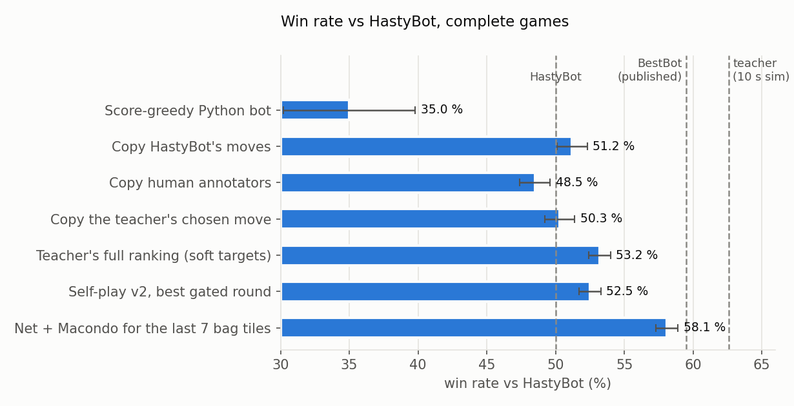

All numbers are complete games against Macondo's **HastyBot** (static equity; about the level of the best few dozen humans),
NWL23, thousands of games per row, first seat alternating. For scale: Macondo's **BestBot** (minutes-per-move simulation) is
published at 59–60 % against HastyBot; our teacher, Macondo's SIMMING_BOT at 10 s/move on one thread, measures 62.6 %.

| Player | vs HastyBot |
|---|---|
| Our net alone (one forward pass per move) | **53.2 % ± 0.8** (4000 games) |
| Our net + Macondo's solvers for the last 7 bag tiles | **58.1 % ± 0.8** (4000 games) |
| Self-play so far (best gated round) | 52.5 % ± 0.8 — no gain over the starting net yet |

## Main findings

### 1. The lexicon memory retrieves every word (Sep 26–27)
A dense query over rack, unseen tiles and board, scored against letter-composition keys for all 196,601 NWL23 words:
NDCG@32 0.97 (GADDAG-style baseline 0.54); every playable word in the dictionary lands in the top 32 of its rules mask; words
held out of training behave like trained ones (the letter encoder, not a per-word table, carries retrieval). An imagined latent
two half-moves ahead keeps the detail (retrieval 0.87 vs 0.95 direct). Details: [docs/scrabble_problem.md §14](docs/scrabble_problem.md).

### 2. Imitation reproduces its teacher (Sep 27)
A 3.9M-parameter policy trained on 30k HastyBot games plays HastyBot to a draw (51.2 % ± 1.1, 81 % top-1 agreement).
Imitating 27k human tournament games is slightly weaker (48.5 %).

### 3. Learning the teacher's full ranking beats HastyBot without search (Oct 2)
Labelling positions with SIMMING_BOT's top-16 candidates and their simulated win % (soft targets), instead of its single pick,
gives the first net that beats HastyBot with no search: **53.2 % ± 0.8** on 4000 fresh games (≈ +22 Elo; Macondo's published
CNN evaluator: 51.7 %). Training on the teacher's chosen move alone gives nothing (50.3 %).

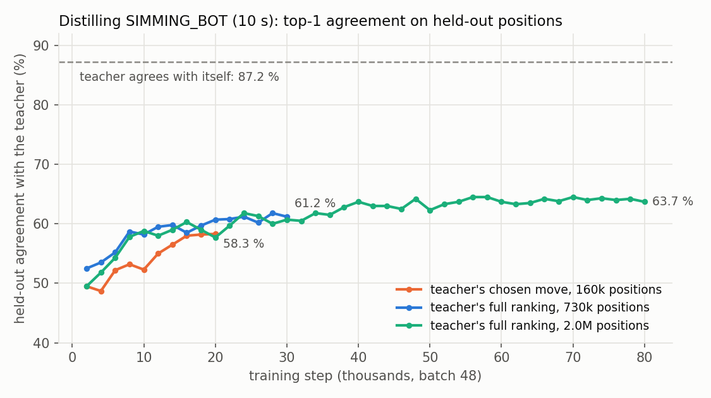

More data raises agreement with the teacher (61 % → 64 % at 2.0M positions) but not the win rate; the teacher itself agrees with
itself 87 % of the time, so the labels are not the limit.

### 4. Games are decided at the end of the bag (Oct 5–7)
Pricing every move of the net with the teacher's own win % on 22,868 held-out positions: the opening and middle game cost
~0.3 win-% points per move, the last 1–7 tiles in the bag 3.5 — 8 % of positions, 41 % of the total loss.

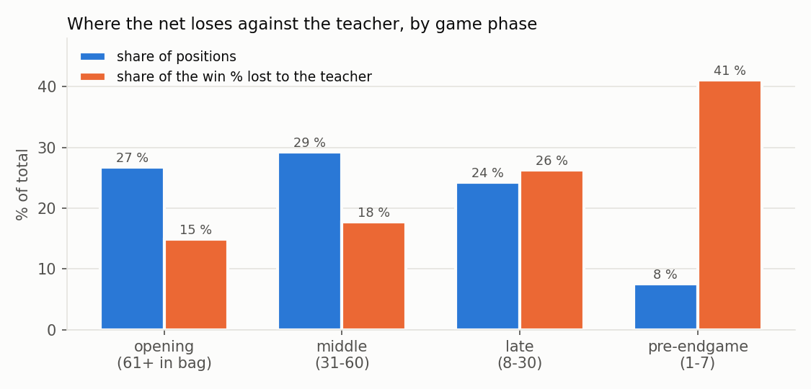

Handing exactly that stretch to Macondo's solver turns 53.2 % into **58.1 %**, within ~13 Elo of published BestBot:

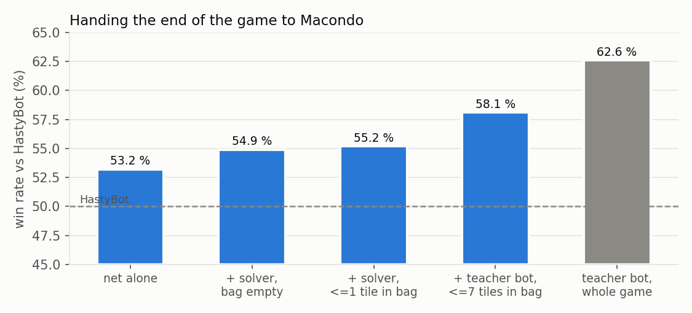

### 5. A fast self-play engine (Oct 13–14)
Macondo (Go) plays the rules, our net picks every move from a GPU inference server over a Unix socket: ~76k games/hour per GPU,
~46× our Python engine per CPU core. Parity against the Python pipeline: identical scores, ~99 % identical move sets, logits
correlated ≥ 0.9993 — and it exposed a scoring bug for blank plays in our Python move generator (premiums and cross words were
ignored), now fixed.

### 6. Self-play: what has and hasn't worked
- **Q-learning (act by argmax Q):** collapses (53 % → 3 %): the max over noisy estimates picks the luckiest error.
- **Actor-critic with a gate** (TD value, advantage-weighted updates, KL limit, shared-draw branch pairs): stable, but 50 k-game
  rounds give no gain (52.5 % → 51 %).
- **Is the signal learnable?** Held-out branch pairs: the net's preferred move wins its playout 58.6 % of the time (74 % near the
  end) — real signal — but training on 136k pairs does not raise that. One branch pair's outcome has sd 0.58 against effects of
  ~0.01–0.03. The Go engine cuts the noise to sd 0.33 (paired bags, 3-turn horizon + value); a 1M-game / ~2.5M-pair run is the
  current test of whether volume makes the signal learnable.

## Architecture

### Overview
The rules are exact and hand-written; everything that is a judgement (which move, how good a position is) is learned.
A position becomes a set of tokens; the candidate moves are tokens too, and the policy picks one of them.

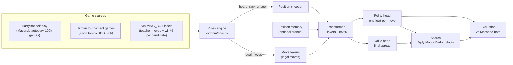

### Rules engine and data (`lexmem/core.py`, `lexmem/replay.py`, `lexmem/gcg.py`)
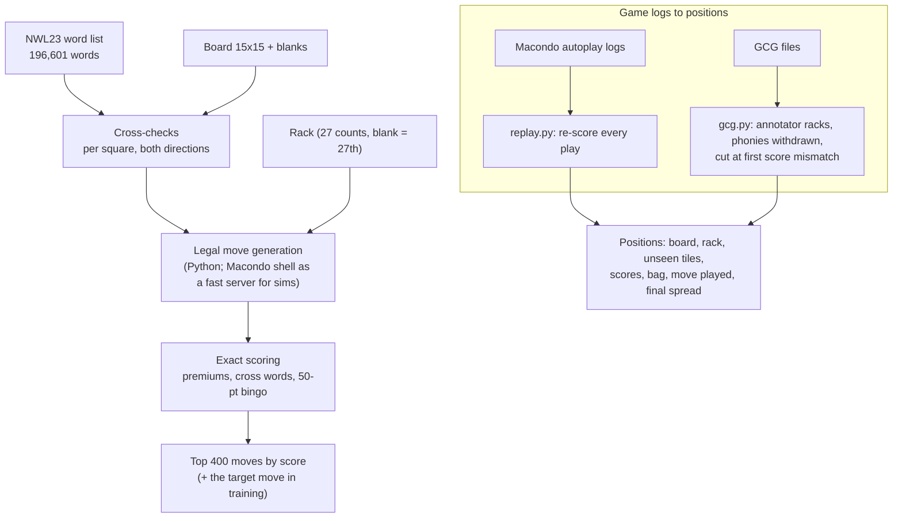
Unseen = full bag minus board minus my rack (the opponent's rack is part of it). Every replayed play is checked against
the logged score.

### Position encoder (`PolicyNet`, `lexmem/policy.py`)
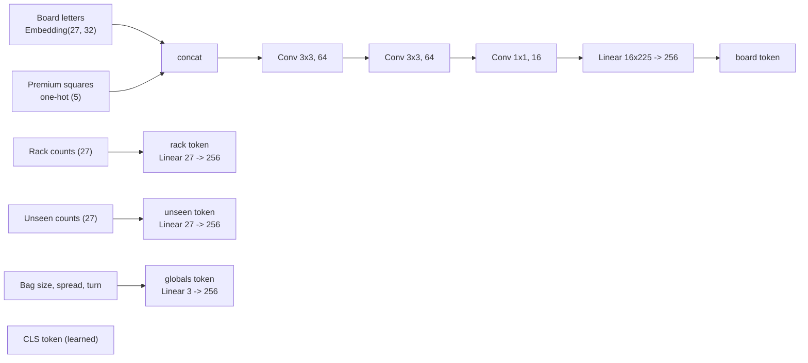
Each token gets a learned type embedding. These five tokens are the whole position; there are no hand-made features
such as leave values.

### Lexicon memory (`QueryEncoder`, `WordEncoder`, `lexmem/model.py`)
The project's one new idea: the net looks up the words it could build, including words 1-3 draws away, instead of
seeing only the moves playable now.
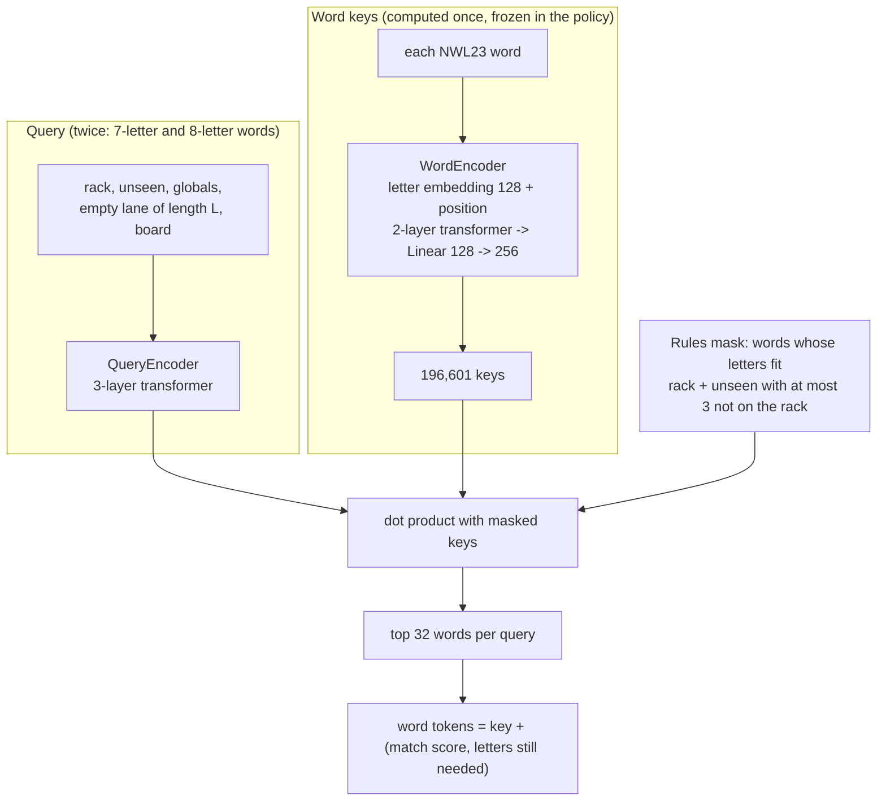
Keys and query encoder are pretrained on the reachability task (`feas2_lexmem.py`: NDCG@32 0.97, every playable word in
the top 32 of its mask). In the policy the retrieved words are 64 extra tokens (`USE_LEX=1`).

### Move tokens, transformer and heads
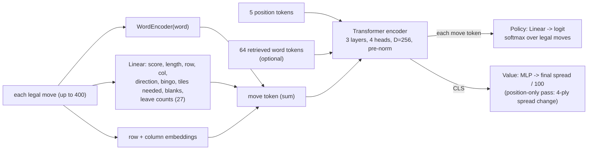
3.9M parameters without the lexicon branch. Every move token attends to the position and to every other move, so the
policy compares moves directly rather than scoring each one alone.

### Search (`lexmem/sim.py`, `lexmem/search.py`)
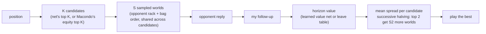
Best result so far: Macondo candidates + learned value at the horizon, 52.5 % vs HastyBot.

### Training and evaluation
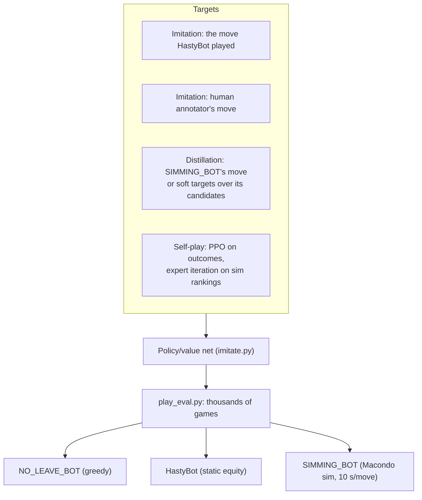
Opponents run through `bin/lexmem_bot` (`cmd/lexmem_bot` in our Macondo checkout on LUMI), which plays any Macondo bot
code and, with `CANDS=K`, also returns the sim's top-K candidates with win probabilities.

### 7. The lexicon memory in controlled tests: no gain yet (Oct 15–22)
Same data, same training, near-equal parameters, the only difference being retrieval over the whole lexicon. On which of two
moves wins a shared-draw playout (251k held-out pairs) and on position value learned from our own rollouts (3 seeds; 10k–177k
training positions), the memory arm is indistinguishable from the control — it predicts words well (opponent's next word in the
top 8 of its lane: 0.42–0.44) but that has not turned into better evaluation. Round summary and next directions:
[docs/round1_summary.md](docs/round1_summary.md).

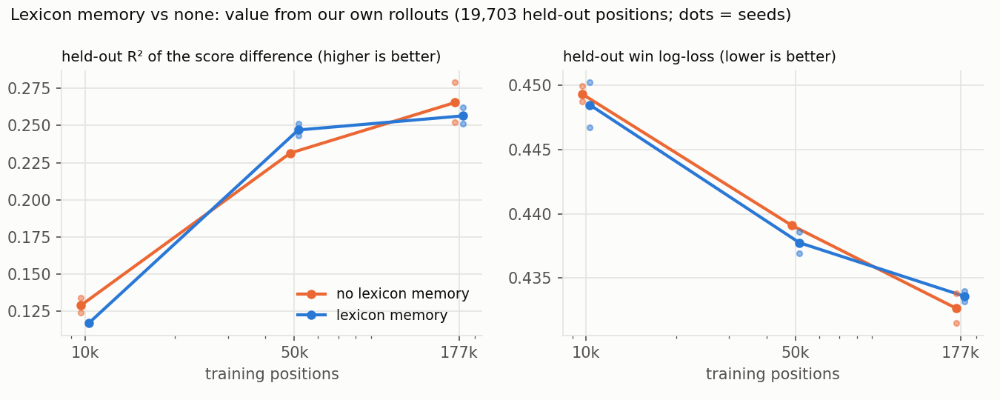

### 8. First positive result: the memory learns planning from far less data (Oct 22–26)
A benchmark with exact answers: for each candidate move, the opponent's expected best reply and my expected best next play,
computed by enumeration over the whole dictionary (256 shared tile samples each; no teacher, no value net). Without the memory
the net cannot rank candidates by the opponent's threat at all until ~40k training positions (within-position R² ≤ 0.02); with
it, 1k positions already give 0.13 and 10k give 0.21. Decisions follow at small data — critical-position regret 4.58 vs 5.29 points
at 3k positions, 4.40 vs 4.67 at 10k — and the control catches up as data grows (3.89 vs 4.06 at 270k). The memory acts as a
**sample-efficiency prior for word-dependent planning**. Details: [docs/benchmarks.md](docs/benchmarks.md#planning-benchmark-round-2a-2026-10-22--25).

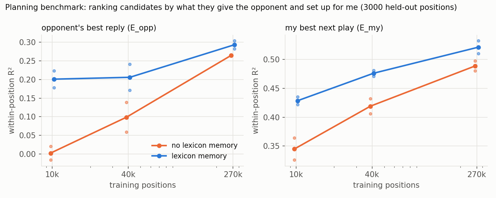

### 9. …and it shows up in games, by about 2 points (Oct 27; two seeds Nov 17)
A planning policy — among the top 16 plays by score, play the one with the best predicted score − E_opp + E_my — against
HastyBot, 4000 games per run on shared seeds. Planning is worth +12 points of win rate (top score 36.6 %, exact planner 48.2 %).
With seed-0 nets the memory planner led by +4.4 points at 3k positions; seed 1's control is as strong as the memory arm, and
over both seeds the lead is **+2.2 ± 0.6 at 3k, +1.7 ± 0.6 at 10k and −0.4 ± 0.6 at 270k** (game noise only; seeds vary more
than that). The memory's sample-efficiency advantage reaches games, smaller than the first run suggested.

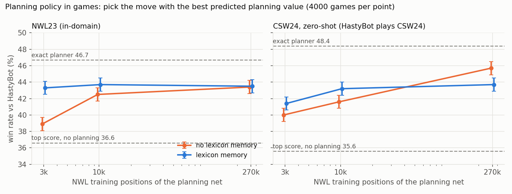

### 10. Dictionary transfer: the memory loses less on the benchmark, not in games (Nov 1)
Planners trained on NWL23 positions, evaluated zero-shot on the same positions relabelled under CSW24 (+88k words). Both arms
transfer with little loss, and the memory arm loses less: at 270k training positions the critical-position regret gap grows from
0.17 points (NWL) to 0.43 (CSW zero-shot), and the NWL-trained memory planner (4.00) matches a no-memory planner trained on 270k CSW
positions (4.05). At small data the memory's advantage is as large as in NWL. Details:
[docs/benchmarks.md](docs/benchmarks.md#dictionary-transfer-nwl23--csw24-round-2d-2026-11-01).

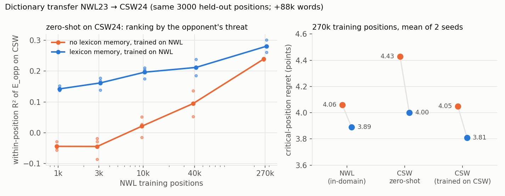

In games the transfer advantage does not appear. The same nets against HastyBot playing CSW24 (right panel of the games figure in
finding 9; two seeds): planning is worth +12.5 points (top score 35.6 %, exact planner 48.1 %), and the memory planner's lead is
+0.9 ± 0.6 at 3k, +2.3 ± 0.6 at 10k and −0.7 ± 0.6 at 270k — the same size as in NWL, not larger.

### 11. Without cross-check sets the control does not collapse (Nov 1)
Isolation test: both arms retrained with the cross-check letters removed from their lane tokens, the control's only
dictionary-derived input. The prediction was that the control would collapse, especially on CSW. It did not: within-position R²
moves by at most 0.03 for either arm, in-domain and on CSW, and the memory's lead on ranking by the opponent's threat is unchanged
(on CSW: 0.17 vs −0.03 at 3k, 0.29 vs 0.23 at 270k). The control learns the word regularities it needs from the labelled positions
themselves, given enough of them; so far the memory buys **sample efficiency, not a higher ceiling**. Caveat: both arms share a
frozen query encoder pretrained on NWL future-word prediction, so the control is not fully dictionary-free.

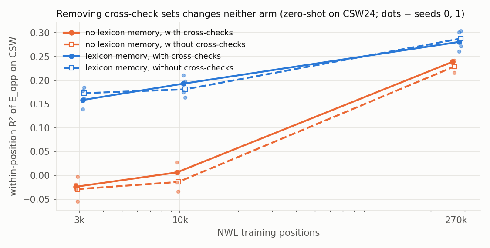

### 12. The exact-label tool had an endgame bug (Nov 17)
Building the two-turn labeller, a check against full move enumeration showed that `go/lexmem_plan` missed the best play in 4 % of
evaluations: with the game attached, an empty sampled bag switched Macondo's shadow search to endgame bounds while plays were
ranked by raw score. Its tile samples were also neither reproducible nor shared across candidates. Fixed (deterministic, exact on
every checked evaluation). The old labels were biased by +0.8 points only at the end of the game and otherwise just noisier;
the round-2 checkpoints re-scored on corrected labels keep the same lex vs no-lex gaps, and the exact planner gains 1.5 points
in NWL games (48.2 %). Details: [docs/benchmarks.md](docs/benchmarks.md#round-3-2026-11-17).

### 13. A control that trains its own encoder decides as well as the memory (Nov 17)
Clean control: no memory, no cross-checks, and a query encoder trained from scratch instead of the frozen word-prediction
encoder both round-2 arms used. It has no dictionary-trained part at all — and it is better than the round-2 control on every
metric, and its **decisions are at least as good as the memory arm's at every size**, in-domain and zero-shot on CSW (critical
regret 4.35 vs 4.48 at 3k, 3.84 vs 4.15 at 270k; means of two seeds, gaps of 0.04–0.31 points, comparable to the seed spread). The memory still ranks candidates by the opponent's threat better at 3k–10k (within-position R²
0.18 vs 0.03–0.10). Caveat: the clean control trains 6.4M parameters, the memory arm 3.6M (its encoder stays frozen); the test that
isolates the memory is a memory arm with a trainable encoder.

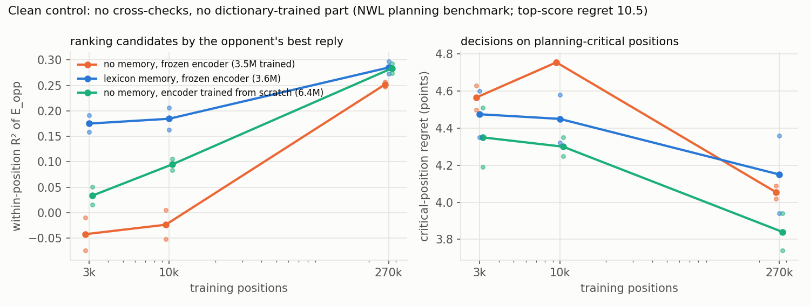

### 14. Two-turn planning: same picture as one turn (Nov 17)
Exact two-turn labels on the same 300k positions: the opponent's best reply is played, then my best answer, then the opponent's
next play (PV2 = score − E_opp + E_my2 − E_opp2). The two-turn answer differs from the one-turn answer in 29 % of positions. The
memory arm is clearly better at small data (critical regret 4.16 vs 5.15 at 3k, 3.82 vs 4.62 at 10k, both seeds) and the arms
converge by 270k (3.27 vs 3.41) — a larger horizon does not open a gap that data cannot close. (Against the frozen-encoder
control.)

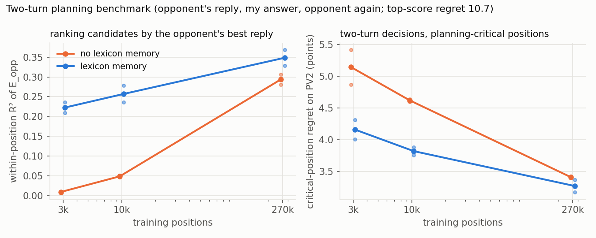

### 15. Capacity-matched: memory helps at small data and on two turns at full data (Nov 18)
The memory arm now trains its pretrained query encoder too (6.44M trainable parameters vs 6.37M for the clean control; no
cross-checks anywhere). On one turn, with the same start and capacity, memory decides better at every size (critical regret 4.05 vs
4.35 at 3k, 3.95 vs 4.12 at 270k). However, the pretrained encoder is a handicap for a no-memory net, and against the best
no-memory net (encoder from scratch) the memory arm wins only at 3k (4.05 vs 4.35, both seeds; 4.42 vs 5.20 on
dictionary-sensitive CSW positions). At 10k and 270k it is 0.1 points behind. On two turns the memory arm is better at 3k (3.74 vs
4.30) and at **270k (3.14 vs 3.56, both seeds)**, the first full-data decision gain for the memory and the best two-turn net so far.
Open control: a two-turn no-memory net with the same pretrained, trainable encoder. Details:
[docs/benchmarks.md](docs/benchmarks.md#round-4-2026-11-18-capacity-matched-memory-test).

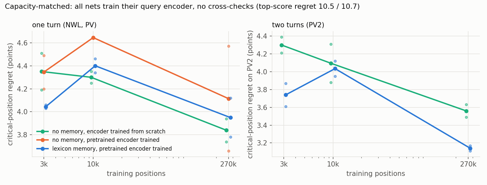

## Repository layout

| Folder | Contents |
|---|---|
| `lexmem/` | library: rules engine and exact scoring (`core.py`), policy/value net and dataset (`policy.py`), lexicon memory (`model.py`, `data.py`), game replays (`replay.py`, `gcg.py`), Macondo integration (`harness.py`, `macondo_gen.py`, `kwg.py`), search (`sim.py`, `search.py`) |
| `prep/` | data: cross-tables crawl and GCG replay, HastyBot game replay, teacher labelling (`label_bot.py`), Go-engine output conversion |
| `train/` | imitation and distillation (`imitate.py`), value / belief / future-word heads, self-play trainers (`train_td.py`, `train_v2.py`, `train_branch.py`) |
| `selfplay/` | Python self-play generators and the GPU inference server for the Go engine (`server_infer.py`) |
| `eval/` | games vs Macondo bots (`play_eval.py`), cost diagnostics, Go/Python parity, sample boards, ONNX export |
| `feasibility/` | the original step 1–4 feasibility experiments for the lexicon memory |
| `go/` | Go sources built inside a Macondo checkout: bot wrapper, fast self-play engine, a one-line Macondo patch |
| `lumi/` | Slurm job scripts and the LUMI notes ([lumi/README.md](lumi/README.md)) |
| `tools/` | figures (`make_figures.py`) and older plotting scripts |
| `docs/` | problem statement, benchmarks, figures, sample positions |

Data, checkpoints, logs and word lists are not in git (NWL23 is licensed); the full working copy lives on LUMI.

## Getting started

```bash
pip install -r requirements.txt
# Macondo (Go 1.23): HastyBot, SIMMING_BOT, fast move generation
git clone https://github.com/domino14/macondo && cd macondo && make macondo_shell && go run ./cmd/fetch_lexica -data-path ./data
cp ../scrabble-lexmem/go/macondo_patch/lexmem_accessor.go ai/bot/
mkdir -p cmd/lexmem_bot cmd/lexmem_selfplay && cp ../scrabble-lexmem/go/lexmem_bot/main.go cmd/lexmem_bot/ && cp ../scrabble-lexmem/go/lexmem_selfplay/main.go cmd/lexmem_selfplay/
go build -o bin/lexmem_bot ./cmd/lexmem_bot && go build -o bin/lexmem_selfplay ./cmd/lexmem_selfplay
# word list (our word order = data/NWL23.txt)
cd ../scrabble-lexmem && python lexmem/kwg.py ../macondo/data/lexica/gaddag/NWL23.kwg data/NWL23.txt
export MACONDO=../macondo PYTHONPATH=.
```

All scripts run from the repo root with `PYTHONPATH=.`; data lives in `data/` (`data/games_<tag>.pkl`, `data/policy_<tag>.pt`).

## Training setups

**1. Games and labels**
```bash
# HastyBot self-play via Macondo autoplay, replayed into our format (every play re-scored)
python prep/replay_all.py <macondo-autoplay-dir> hasty 2000           # -> data/games_hasty_{train,test}.pkl
# human tournament games from cross-tables
python prep/xt_crawl.py index && python prep/xt_crawl.py gcg NWL,TWL && python prep/gcg_all.py data/xt/gcg human 1000
# teacher labels: SIMMING_BOT, 10 s per position, top-16 candidates with win % (soft targets)
TEACHER=SIMMING_BOT SECS=10 CANDS=16 SRC=hasty_train_full NPROC=64 python prep/label_bot.py 30000 31000 simsoft_0
```

**2. Imitation / distillation** (the 53.2 % net: soft targets from scratch, 730k positions, 30k steps × 48)
```bash
TRAIN=simsoft_0,...,simsoft_30 TEST=simsoft_31 USE_LEX=0 EI=1 TAU=1.0 MARGIN=0 BETA=0 STEPS=30000 B=48 TAG=simsoft_scratch_nolex python train/imitate.py
# add EXCH=1 for exchange moves, CW=1 for cost weighting, INIT=<ckpt> to fine-tune, USE_LEX=1 RETR=data/lexmem_nwl.pt for the lexicon branch
```

**3. Evaluation**
```bash
CKPT=data/policy_simsoft_scratch_nolex.pt NPROC=60 python eval/play_eval.py 4000 777000                       # vs HastyBot
CKPT=... OPP=SIMMING_BOT OPP_SECS=10 NPROC=48 python eval/play_eval.py 1000                                    # vs any Macondo bot
CKPT=... ENDGAME=8 EG_SECS=10 NPROC=48 python eval/play_eval.py 4000 777000                                   # net + Macondo for the last 7 bag tiles
CKPT=... TEST=simsoft_31 python eval/diag_cost.py                                                             # cost of the net's moves by phase
```

**4. Self-play**
```bash
# Python track (actor-critic + branch pairs + gate), see lumi/v2_rounds.sh
CKPT=<ckpt> P_BRANCH=0.04 NPROC=124 TAG=v2_w_g1_0 python selfplay/selfplay_v2.py 12500 1
TRAIN=v2_w_g1_0,... INIT=<ckpt> TAG=v2_w_g1 python train/train_v2.py
# Go engine: GPU server + engine (lumi/sp_fast.sh, lumi/sp_branch_gen.sh)
CKPT=<ckpt> SOCK=/tmp/lexmem.sock python selfplay/server_infer.py &
(cd $MACONDO && LEXWORDS=$PWD/../scrabble-lexmem/data/lexwords.txt SOCK=/tmp/lexmem.sock NGAMES=10000 CONC=1024 BATCH=2048 P_BRANCH=0.1 H=3 OUT=games.jsonl ./bin/lexmem_selfplay)
BRANCH_ONLY=1 python prep/go2pkl.py games.jsonl spb_0 && TRAIN=spb_0 INIT=<ckpt> TAG=branch_test python train/train_branch.py
```

**5. Planning benchmark and the lexicon-memory tests** (findings 8–11)
```bash
# positions from Go self-play -> CGP lines -> exact labels by enumeration (go/lexmem_plan; on LUMI as an array: lumi/plan_label.sh)
python prep/plan_positions.py sample spf_0 300000 data/plan_in.jsonl
(cd $MACONDO && LEXICON=NWL23 LEXWORDS=$PWD/../scrabble-lexmem/data/lexwords.txt K=16 S=256 ./bin/lexmem_plan < plan_in.jsonl > plan_out.jsonl)
python prep/plan_positions.py merge spf_0 data/plan_in.jsonl data/plan_out.jsonl v1          # -> data/plan_v1.pkl
# lex vs no-lex at a fixed training size (query encoder frozen in both arms); NO_XCHK=1 removes the cross-check letters
ARM=lex SEED=0 MAX_TRAIN=3000 STEPS=4000 B=64 NEV_POS=3000 HOLDOUT_MOD=10 TAG=lexplan_lex_3000_s0 python train/train_lexplan.py
# query encoder: QINIT=fut (pretrained, frozen; default) | fut_train (pretrained, trained) | random (fresh, trained)
# two-turn labels (lexmem_plan H2=1, merged in plan_v1 order with ORDER_REF=data/plan_v1.pkl): HORIZON=2 DATA=data/plan_h2.pkl
# eval only, another dictionary (word keys rebuilt from the frozen letter encoder), plus the dictionary-sensitive quarter
ARM=lex DATA=data/plan_csw.pkl LEXICON=data/CSW24.txt SENS_REF=data/plan_v1.pkl EVAL_CKPTS=data/lexplan_lex_3000_s0.pt NEV_POS=3000 HOLDOUT_MOD=10 python train/train_lexplan.py
# planning policies in games: PLAN=net (PLAN_ARM, PLAN_CKPT) | exact | topscore
PLAN=net PLAN_ARM=lex PLAN_CKPT=data/lexplan_lex_3000_s0.pt NPROC=60 python eval/play_eval.py 4000 777000
# ... under CSW24 (HastyBot, exact planner and our engine all switch dictionary)
LEXICON=data/CSW24.txt MACONDO_LEX=CSW24 PLAN_WORDS=data/lexwords_csw.txt PLAN=exact NPROC=60 python eval/play_eval.py 4000 777000
```

## Pitfalls worth knowing
- Win-rate differences of 1–2 points need thousands of games; compare nets on the same seeds (`play_eval.py ... 777000`) and with
  more than one training seed (seed spread exceeds game noise). Since 2026-11-01 `play_eval.py` stores each game's spread at its
  game index (`tools/paired_games.py` pairs runs game by game); earlier pickles are in completion order, so their printed
  first/second-seat splits are meaningless, and planner runs before then overwrote one another's file.
- `go/lexmem_plan`: never attach the game to a score-only top-play generator (endgame shadow bounds); run `CHECK=1` after changes.
- Macondo's endgame table takes 20 % of the node's RAM per process unless `GOMEMLIMIT` is set (the harness sets 2 GiB); its endgame
  solver can return an empty sequence on time-out (our wrapper falls back to the static move).
- Scores of blank plays: always use `legal_moves` / `designate` (exact); Python self-play data from before 2026-10-13 used inflated
  blank-play scores.
- The policy only sees the top 400 plays by score plus exchanges (with `EXCH=1`); passes happen only when nothing else is legal.
- Feasibility scripts: in `feas2_retrieval.py` the NOW and coverage metrics are degenerate (mask == label); report retrieval
  metrics conditioned on mask size; `feas1b` ignores cross-checks.
