# scrabble-lexmem

Can a learned model play Scrabble at the top level by learning the game itself — strategy and sequences — instead of a
hand-built evaluation plus brute-force search? This repo holds the rules engine, a policy/value network with a lexicon-memory
layer, imitation and distillation pipelines, two self-play tracks, a fast Go + GPU self-play engine, and the evaluation
harness against Macondo's bots. The problem statement, prior work and design are in [docs/scrabble_problem.md](docs/scrabble_problem.md);
every result with its provenance is in [docs/benchmarks.md](docs/benchmarks.md).

## Results at a glance

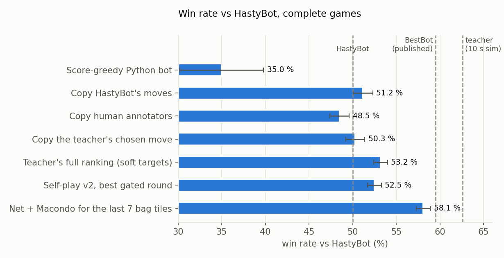

All numbers are complete games against Macondo's **HastyBot** (static equity; about the level of the best few dozen humans),
NWL23, thousands of games per row, first seat alternating. For scale: Macondo's **BestBot** (minutes-per-move simulation) is
published at 59–60 % against HastyBot; our teacher, Macondo's SIMMING_BOT at 10 s/move on one thread, measures 62.6 %.

| Player | vs HastyBot |
|---|---|
| Our net alone (one forward pass per move) | **53.2 % ± 0.8** (4000 games) |
| Our net + Macondo's solvers for the last 7 bag tiles | **58.1 % ± 0.8** (4000 games) |
| Self-play so far (best gated round) | 52.5 % ± 0.8 — no gain over the starting net yet |

## Main findings

### 1. The lexicon memory retrieves every word (Sep 26–27)
A dense query over rack, unseen tiles and board, scored against letter-composition keys for all 196,601 NWL23 words:
NDCG@32 0.97 (GADDAG-style baseline 0.54); every playable word in the dictionary lands in the top 32 of its rules mask; words
held out of training behave like trained ones (the letter encoder, not a per-word table, carries retrieval). An imagined latent
two half-moves ahead keeps the detail (retrieval 0.87 vs 0.95 direct). Details: [docs/scrabble_problem.md §14](docs/scrabble_problem.md).

### 2. Imitation reproduces its teacher (Sep 27)
A 3.9M-parameter policy trained on 30k HastyBot games plays HastyBot to a draw (51.2 % ± 1.1, 81 % top-1 agreement).
Imitating 27k human tournament games is slightly weaker (48.5 %).

### 3. Learning the teacher's full ranking beats HastyBot without search (Oct 2)
Labelling positions with SIMMING_BOT's top-16 candidates and their simulated win % (soft targets), instead of its single pick,
gives the first net that beats HastyBot with no search: **53.2 % ± 0.8** on 4000 fresh games (≈ +22 Elo; Macondo's published
CNN evaluator: 51.7 %). Training on the teacher's chosen move alone gives nothing (50.3 %).

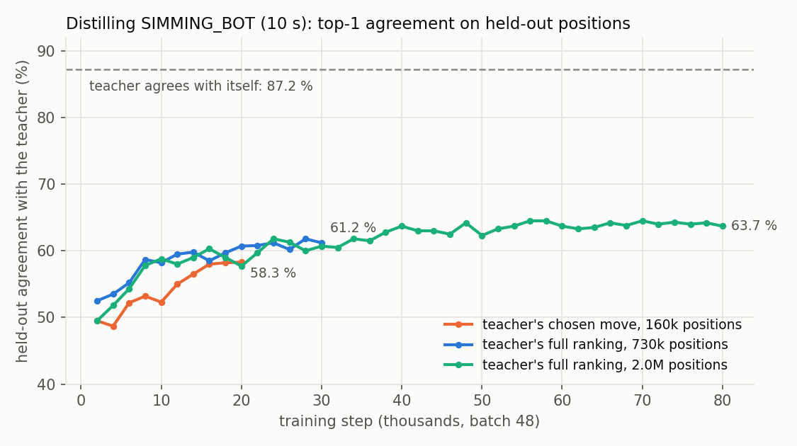

More data raises agreement with the teacher (61 % → 64 % at 2.0M positions) but not the win rate; the teacher itself agrees with
itself 87 % of the time, so the labels are not the limit.

### 4. Games are decided at the end of the bag (Oct 5–7)
Pricing every move of the net with the teacher's own win % on 22,868 held-out positions: the opening and middle game cost
~0.3 win-% points per move, the last 1–7 tiles in the bag 3.5 — 8 % of positions, 41 % of the total loss.

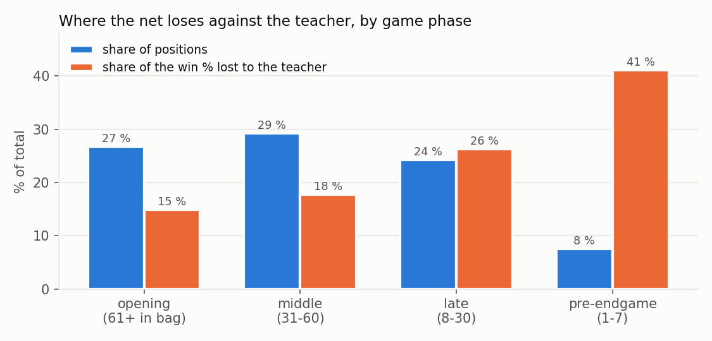

Handing exactly that stretch to Macondo's solver turns 53.2 % into **58.1 %**, within ~13 Elo of published BestBot:

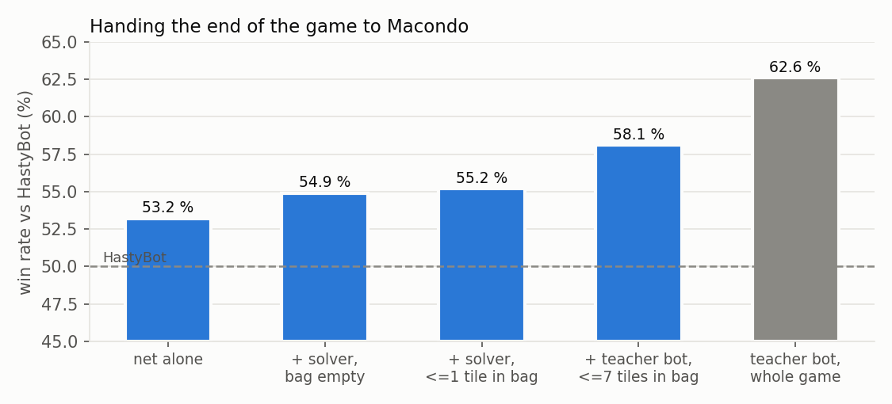

### 5. A fast self-play engine (Oct 13–14)
Macondo (Go) plays the rules, our net picks every move from a GPU inference server over a Unix socket: ~76k games/hour per GPU,
~46× our Python engine per CPU core. Parity against the Python pipeline: identical scores, ~99 % identical move sets, logits
correlated ≥ 0.9993 — and it exposed a scoring bug for blank plays in our Python move generator (premiums and cross words were
ignored), now fixed.

### 6. Self-play: what has and hasn't worked
- **Q-learning (act by argmax Q):** collapses (53 % → 3 %): the max over noisy estimates picks the luckiest error.
- **Actor-critic with a gate** (TD value, advantage-weighted updates, KL limit, shared-draw branch pairs): stable, but 50 k-game
  rounds give no gain (52.5 % → 51 %).
- **Is the signal learnable?** Held-out branch pairs: the net's preferred move wins its playout 58.6 % of the time (74 % near the
  end) — real signal — but training on 136k pairs does not raise that. One branch pair's outcome has sd 0.58 against effects of
  ~0.01–0.03. The Go engine cuts the noise to sd 0.33 (paired bags, 3-turn horizon + value); a 1M-game / ~2.5M-pair run is the
  current test of whether volume makes the signal learnable.

## Architecture

### Overview
The rules are exact and hand-written; everything that is a judgement (which move, how good a position is) is learned.
A position becomes a set of tokens; the candidate moves are tokens too, and the policy picks one of them.

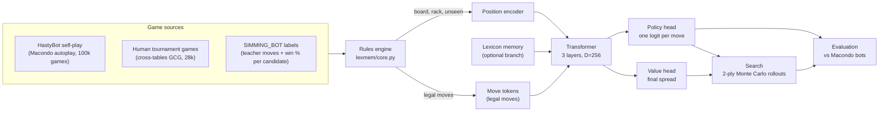

### Rules engine and data (`lexmem/core.py`, `lexmem/replay.py`, `lexmem/gcg.py`)
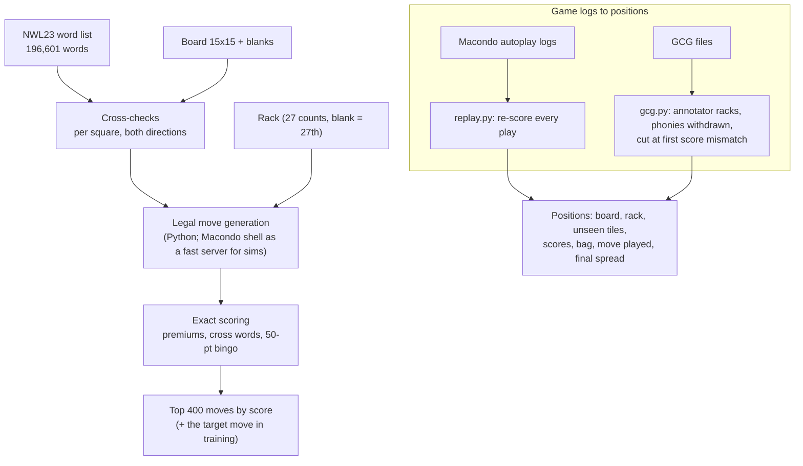
Unseen = full bag minus board minus my rack (the opponent's rack is part of it). Every replayed play is checked against
the logged score.

### Position encoder (`PolicyNet`, `lexmem/policy.py`)
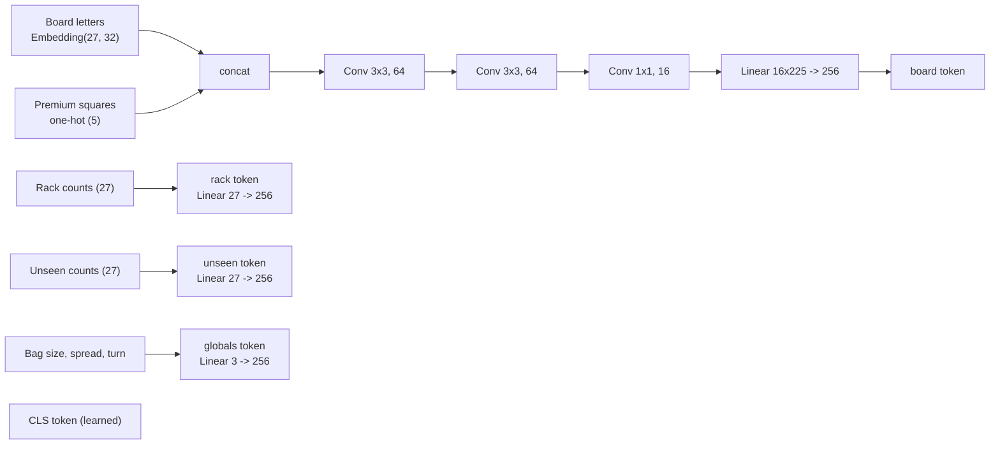
Each token gets a learned type embedding. These five tokens are the whole position; there are no hand-made features
such as leave values.

### Lexicon memory (`QueryEncoder`, `WordEncoder`, `lexmem/model.py`)
The project's one new idea: the net looks up the words it could build, including words 1-3 draws away, instead of
seeing only the moves playable now.
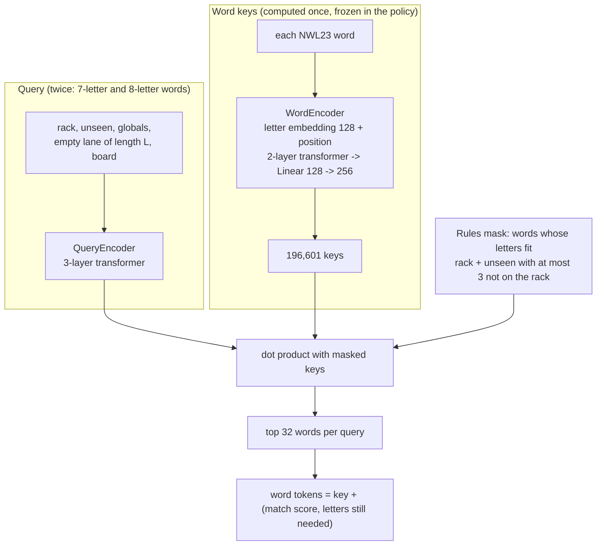
Keys and query encoder are pretrained on the reachability task (`feas2_lexmem.py`: NDCG@32 0.97, every playable word in
the top 32 of its mask). In the policy the retrieved words are 64 extra tokens (`USE_LEX=1`).

### Move tokens, transformer and heads
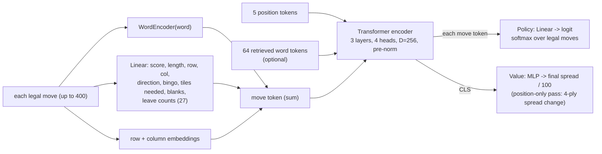
3.9M parameters without the lexicon branch. Every move token attends to the position and to every other move, so the
policy compares moves directly rather than scoring each one alone.

### Search (`lexmem/sim.py`, `lexmem/search.py`)
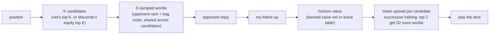
Best result so far: Macondo candidates + learned value at the horizon, 52.5 % vs HastyBot.

### Training and evaluation
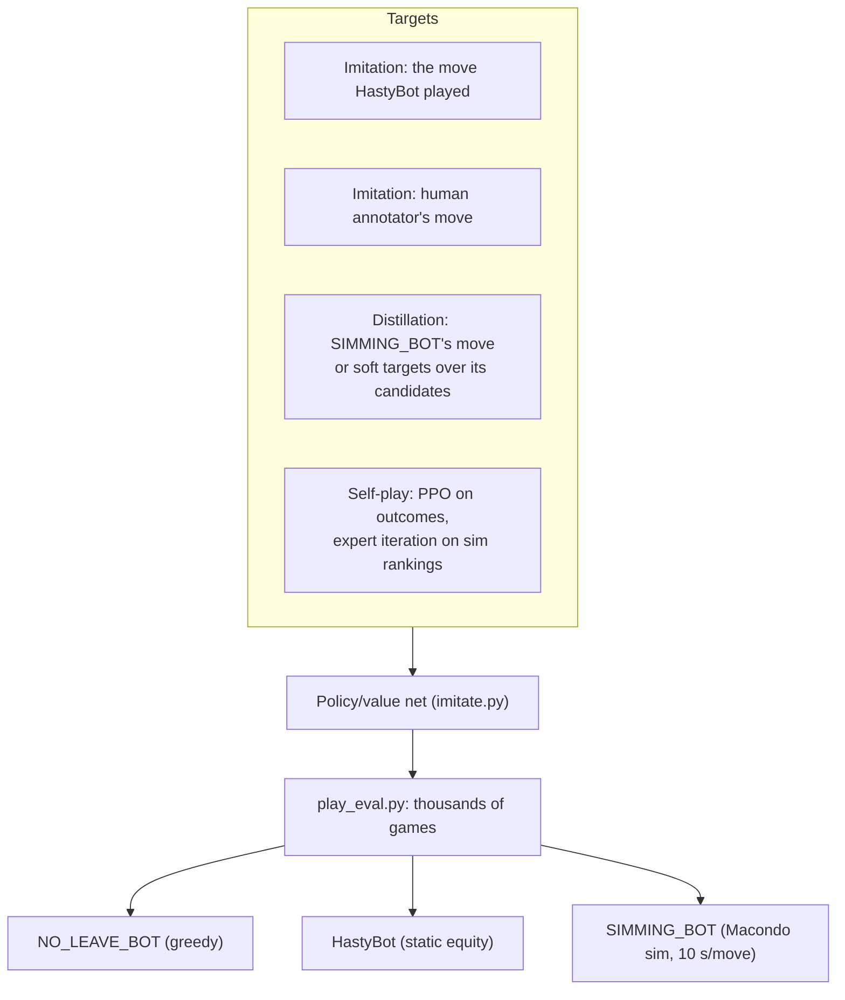
Opponents run through `bin/lexmem_bot` (`cmd/lexmem_bot` in our Macondo checkout on LUMI), which plays any Macondo bot
code and, with `CANDS=K`, also returns the sim's top-K candidates with win probabilities.

### 7. The lexicon memory in controlled tests: no gain yet (Oct 15–22)
Same data, same training, near-equal parameters, the only difference being retrieval over the whole lexicon. On which of two
moves wins a shared-draw playout (251k held-out pairs) and on position value learned from our own rollouts (3 seeds; 10k–177k
training positions), the memory arm is indistinguishable from the control — it predicts words well (opponent's next word in the
top 8 of its lane: 0.42–0.44) but that has not turned into better evaluation. Round summary and next directions:
[docs/round1_summary.md](docs/round1_summary.md).

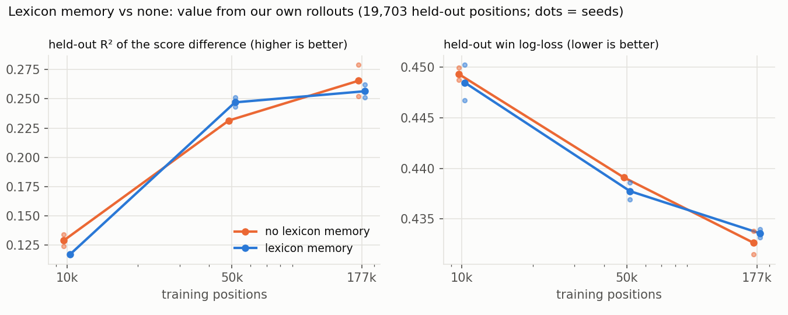

## Repository layout

| Folder | Contents |
|---|---|
| `lexmem/` | library: rules engine and exact scoring (`core.py`), policy/value net and dataset (`policy.py`), lexicon memory (`model.py`, `data.py`), game replays (`replay.py`, `gcg.py`), Macondo integration (`harness.py`, `macondo_gen.py`, `kwg.py`), search (`sim.py`, `search.py`) |
| `prep/` | data: cross-tables crawl and GCG replay, HastyBot game replay, teacher labelling (`label_bot.py`), Go-engine output conversion |
| `train/` | imitation and distillation (`imitate.py`), value / belief / future-word heads, self-play trainers (`train_td.py`, `train_v2.py`, `train_branch.py`) |
| `selfplay/` | Python self-play generators and the GPU inference server for the Go engine (`server_infer.py`) |
| `eval/` | games vs Macondo bots (`play_eval.py`), cost diagnostics, Go/Python parity, sample boards, ONNX export |
| `feasibility/` | the original step 1–4 feasibility experiments for the lexicon memory |
| `go/` | Go sources built inside a Macondo checkout: bot wrapper, fast self-play engine, a one-line Macondo patch |
| `lumi/` | Slurm job scripts and the LUMI notes ([lumi/README.md](lumi/README.md)) |
| `tools/` | figures (`make_figures.py`) and older plotting scripts |
| `docs/` | problem statement, benchmarks, figures, sample positions |

Data, checkpoints, logs and word lists are not in git (NWL23 is licensed); the full working copy lives on LUMI.

## Getting started

```bash
pip install -r requirements.txt
# Macondo (Go 1.23): HastyBot, SIMMING_BOT, fast move generation
git clone https://github.com/domino14/macondo && cd macondo && make macondo_shell && go run ./cmd/fetch_lexica -data-path ./data
cp ../scrabble-lexmem/go/macondo_patch/lexmem_accessor.go ai/bot/
mkdir -p cmd/lexmem_bot cmd/lexmem_selfplay && cp ../scrabble-lexmem/go/lexmem_bot/main.go cmd/lexmem_bot/ && cp ../scrabble-lexmem/go/lexmem_selfplay/main.go cmd/lexmem_selfplay/
go build -o bin/lexmem_bot ./cmd/lexmem_bot && go build -o bin/lexmem_selfplay ./cmd/lexmem_selfplay
# word list (our word order = data/NWL23.txt)
cd ../scrabble-lexmem && python lexmem/kwg.py ../macondo/data/lexica/gaddag/NWL23.kwg data/NWL23.txt
export MACONDO=../macondo PYTHONPATH=.
```

All scripts run from the repo root with `PYTHONPATH=.`; data lives in `data/` (`data/games_<tag>.pkl`, `data/policy_<tag>.pt`).

## Training setups

**1. Games and labels**
```bash
# HastyBot self-play via Macondo autoplay, replayed into our format (every play re-scored)
python prep/replay_all.py <macondo-autoplay-dir> hasty 2000           # -> data/games_hasty_{train,test}.pkl
# human tournament games from cross-tables
python prep/xt_crawl.py index && python prep/xt_crawl.py gcg NWL,TWL && python prep/gcg_all.py data/xt/gcg human 1000
# teacher labels: SIMMING_BOT, 10 s per position, top-16 candidates with win % (soft targets)
TEACHER=SIMMING_BOT SECS=10 CANDS=16 SRC=hasty_train_full NPROC=64 python prep/label_bot.py 30000 31000 simsoft_0
```

**2. Imitation / distillation** (the 53.2 % net: soft targets from scratch, 730k positions, 30k steps × 48)
```bash
TRAIN=simsoft_0,...,simsoft_30 TEST=simsoft_31 USE_LEX=0 EI=1 TAU=1.0 MARGIN=0 BETA=0 STEPS=30000 B=48 TAG=simsoft_scratch_nolex python train/imitate.py
# add EXCH=1 for exchange moves, CW=1 for cost weighting, INIT=<ckpt> to fine-tune, USE_LEX=1 RETR=data/lexmem_nwl.pt for the lexicon branch
```

**3. Evaluation**
```bash
CKPT=data/policy_simsoft_scratch_nolex.pt NPROC=60 python eval/play_eval.py 4000 777000                       # vs HastyBot
CKPT=... OPP=SIMMING_BOT OPP_SECS=10 NPROC=48 python eval/play_eval.py 1000                                    # vs any Macondo bot
CKPT=... ENDGAME=8 EG_SECS=10 NPROC=48 python eval/play_eval.py 4000 777000                                   # net + Macondo for the last 7 bag tiles
CKPT=... TEST=simsoft_31 python eval/diag_cost.py                                                             # cost of the net's moves by phase
```

**4. Self-play**
```bash
# Python track (actor-critic + branch pairs + gate), see lumi/v2_rounds.sh
CKPT=<ckpt> P_BRANCH=0.04 NPROC=124 TAG=v2_w_g1_0 python selfplay/selfplay_v2.py 12500 1
TRAIN=v2_w_g1_0,... INIT=<ckpt> TAG=v2_w_g1 python train/train_v2.py
# Go engine: GPU server + engine (lumi/sp_fast.sh, lumi/sp_branch_gen.sh)
CKPT=<ckpt> SOCK=/tmp/lexmem.sock python selfplay/server_infer.py &
(cd $MACONDO && LEXWORDS=$PWD/../scrabble-lexmem/data/lexwords.txt SOCK=/tmp/lexmem.sock NGAMES=10000 CONC=1024 BATCH=2048 P_BRANCH=0.1 H=3 OUT=games.jsonl ./bin/lexmem_selfplay)
BRANCH_ONLY=1 python prep/go2pkl.py games.jsonl spb_0 && TRAIN=spb_0 INIT=<ckpt> TAG=branch_test python train/train_branch.py
```

## Pitfalls worth knowing
- Win-rate differences of 1–2 points need thousands of games; compare nets on the same seeds (`play_eval.py ... 777000`).
- Macondo's endgame table takes 20 % of the node's RAM per process unless `GOMEMLIMIT` is set (the harness sets 2 GiB); its endgame
  solver can return an empty sequence on time-out (our wrapper falls back to the static move).
- Scores of blank plays: always use `legal_moves` / `designate` (exact); Python self-play data from before 2026-10-13 used inflated
  blank-play scores.
- The policy only sees the top 400 plays by score plus exchanges (with `EXCH=1`); passes happen only when nothing else is legal.
- Feasibility scripts: in `feas2_retrieval.py` the NOW and coverage metrics are degenerate (mask == label); report retrieval
  metrics conditioned on mask size; `feas1b` ignores cross-checks.
