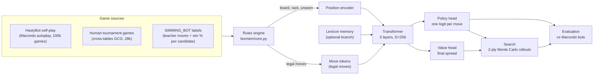
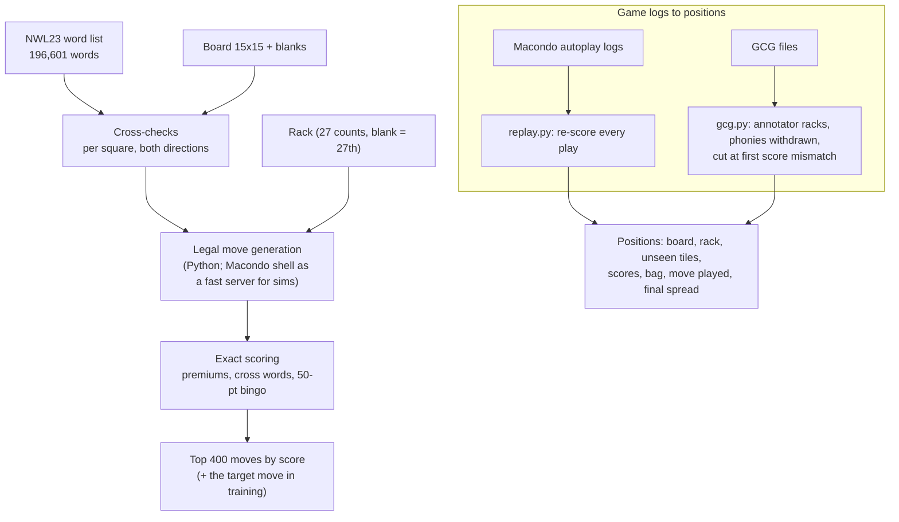
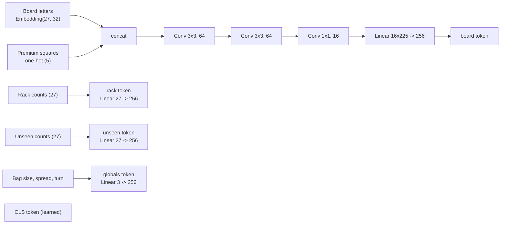
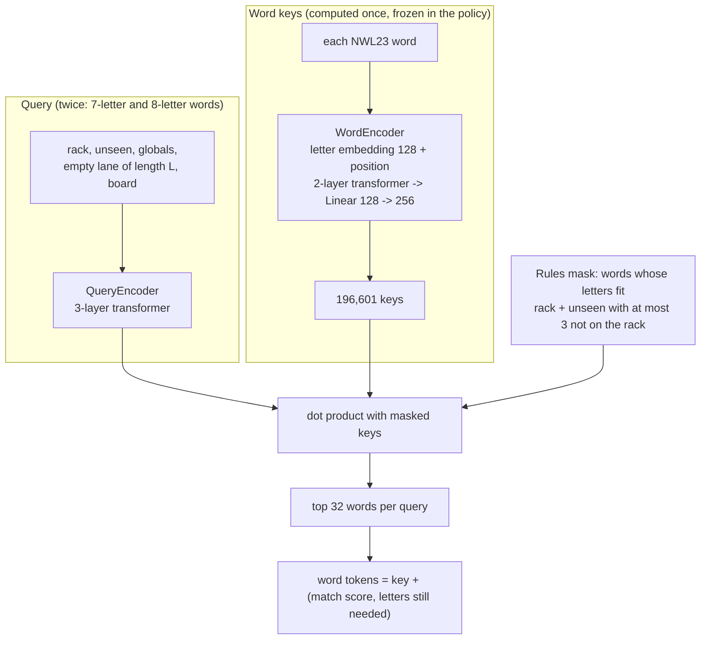
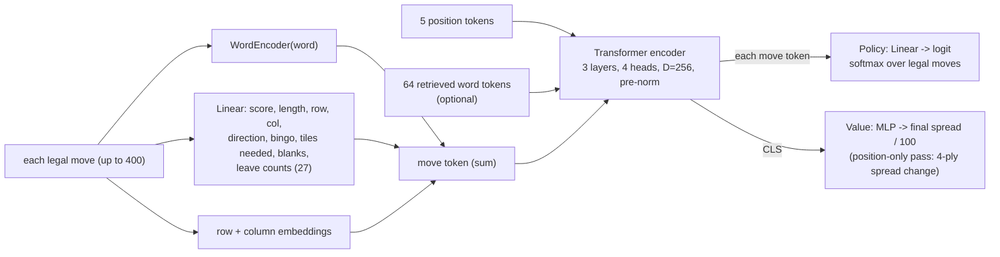
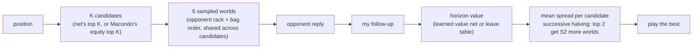
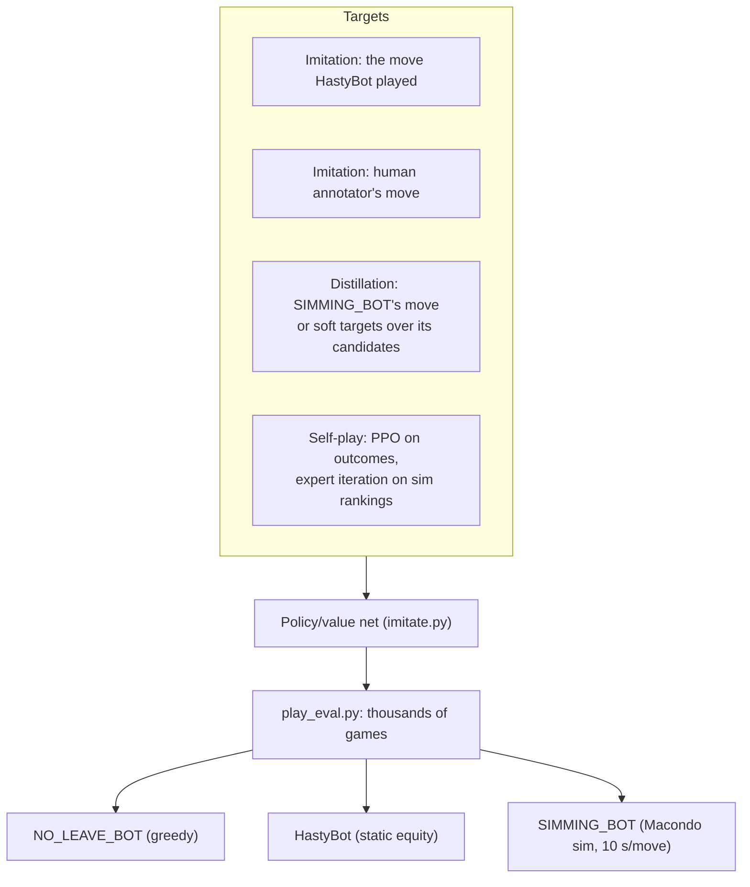

# Scrabble lexicon-memory project — handoff

Read `scrabble_problem.md` first. It is the problem statement, prior work, the
proposed architecture (§14) and the feasibility results so far.

## Architecture

Results with provenance: [docs/benchmarks.md](docs/benchmarks.md). Sample positions with the net's top-5 moves: [docs/samples/positions.md](docs/samples/positions.md).

### Overview
The rules are exact and hand-written; everything that is a judgement (which move, how good a position is) is learned.
A position becomes a set of tokens; the candidate moves are tokens too, and the policy picks one of them.

### Rules engine and data (`lexmem/core.py`, `lexmem/replay.py`, `lexmem/gcg.py`)

Unseen = full bag minus board minus my rack (the opponent's rack is part of it). Every replayed play is checked against
the logged score.

### Position encoder (`PolicyNet`, `lexmem/policy.py`)

Each token gets a learned type embedding. These five tokens are the whole position; there are no hand-made features
such as leave values.

### Lexicon memory (`QueryEncoder`, `WordEncoder`, `lexmem/model.py`)
The project's one new idea: the net looks up the words it could build, including words 1-3 draws away, instead of
seeing only the moves playable now.

Keys and query encoder are pretrained on the reachability task (`feas2_lexmem.py`: NDCG@32 0.97, every playable word in
the top 32 of its mask). In the policy the retrieved words are 64 extra tokens (`USE_LEX=1`).

### Move tokens, transformer and heads

3.9M parameters without the lexicon branch. Every move token attends to the position and to every other move, so the
policy compares moves directly rather than scoring each one alone.

### Search (`lexmem/sim.py`, `lexmem/search.py`)

Best result so far: Macondo candidates + learned value at the horizon, 52.5 % vs HastyBot.

### Training and evaluation

Opponents run through `bin/lexmem_bot` (`cmd/lexmem_bot` in our Macondo checkout on LUMI), which plays any Macondo bot
code and, with `CANDS=K`, also returns the sim's top-K candidates with win probabilities.

## Files
- `scrabble_problem.md`   — the doc. Everything is in here.
- `feas1_alive.py`        — step 1: how many words are alive under the tile mask (no board). Runs in seconds.
- `feas1b_board.py`       — step 1b: adds a board / lane constraint (crude random self-play boards). ~2 min.
- `feas2_retrieval.py`    — step 2 pilot: trains a small lexicon memory layer on constructed positions (CPU, ~4 min at BUDGET=220s). Set env BUDGET (seconds) for longer runs.
- `enable1.txt`           — ENABLE word list (public domain, 172k). Swap for CSW/NWL when available.
- `lexmem/core.py`          — full rules: premiums, cross-checks, exact scoring, lanes, legal move gen, exact reachable label (hypergeometric).
- `lexmem/data.py`, `lexmem/model.py` — dataset (labels on the fly in workers) and the lexicon-memory model.
- `gen_games.py`            — self-play game generator (14 procs; 600 games ≈ 17 min). Output data/games_{train,test}.pkl (not committed).
- `feas2_lexmem.py`         — step 2 proper (GPU, 7 min on a 3080). Results in the doc. Checkpoint data/lexmem_base.pt.
- `feas4_latent.py`         — step 4: MuZero-style latent dynamics with the lexicon head. Written, NOT run (to run on LUMI).
- `macondo_experiments_log.md` — César del Solar's CNN experiment log (evidence for §8).
- `macondo_mlhelper.go`   — Macondo's feature encoding (85 planes / 72 scalars) for reference.

## Status
- Step 1: passed (planning set ~1e4 words; rules mask cuts ~10x; turn-to-turn Jaccard ~0.54).
- Step 2: PASSED (2026-09-26). NDCG@32 0.92 vs 0.51 GADDAG-style baseline; playable-now words in top 7% of the mask,
  1/2/3 letters away in top 16/24/34%; held-out words identical. See doc "Step-2 result".
- Step 3 (delayed): well above chance, not solved (see the 1/2/3-missing percentiles).
- Step 2 at scale (LUMI, 2026-09-27): NDCG 0.97; slots unnecessary; whole-lexicon coverage: 100% of playable words in top-32 of mask.
- Step 4 (latent dynamics, LUMI): imagined-latent retrieval 0.87 at 2 half-moves vs 0.95 direct; loss is at the hidden-rack step.
- Gate 4 (does it learn the game): NOT started. Needs self-play with a real policy (exchanges/passes), belief head, fast movegen.
- No local training — runs go to LUMI. `eval_coverage.py` = whole-dictionary sweep. Results: doc "LUMI runs".

## Next (GPU)
Proper step 2:
1. Full lexicon, d>=256, product-key memory (Lample 2019) or plain 280k-slot table.
2. Real boards: build Macondo (`go build` in cmd/macondo, needs a gaddag), use `autoplay` positions.
3. Well-posed label: for a (rack, U, lane), label = every word reachable within <=2 draws,
   weighted by P(draw from U) * score. Exactly computable. Train listwise / softmax over the mask.
4. Metrics: NDCG over the reachable set; percentile of held-out reachable words; per-word
   coverage sweep over the entire lexicon (every word must be retrievable in some constructed position).
Then step 3 (delayed 1-3 draws, does it retrieve EARLY), then attach to policy/value net.

## Known pitfalls
- In feas2_retrieval.py the NOW and coverage metrics are degenerate (mask == label). Only the
  DELAYED percentile metric (see dbg2 logic in the doc) is meaningful.
- Mask-size distribution is heavily skewed; always report metrics conditioned on mask size.
- feas1b ignores cross-checks: its board numbers are upper bounds.

## LUMI (from 2026-09-26)
- Project `project_462001611`; code + data at `/scratch/project_462001611/scrabble-lexmem` (logs in `logs/`, results/checkpoints in `data/`).
- Env: `module use /appl/local/csc/modulefiles; module load pytorch/2.7` (Singularity container, ROCm). Batch scripts in `lumi/`:
  `smoke.sh` (dev-g, 20 min), `gen.sh` (CPU, 4000+300 games -> data/games_big*.pkl), `feas2.sh` (SLOT/TAG via --export), `feas4.sh`.
- Submit: `sbatch --export=ALL,SLOT=0,TAG=noslot lumi/feas2.sh`. Check: `squeue -u $USER`, `tail logs/*.out`.
- Overnight 2026-09-26 -> 27: gen 22372459; feas2 no-slot 22372477; feas2 slot 22372478; feas4 latent 22372479 (all afterok gen).

## Macondo / HastyBot integration (2026-09-27)
- Macondo built from source (Go 1.23 in user space): LUMI `/scratch/project_462001611/macondo/bin/shell`, local `~/opt/macondo`.
  Lexica + leave values fetched with `go run ./cmd/fetch_lexica -data-path ./data` (NWL23, CSW24, ...).
- Lexicon switched to **NWL23** for anything involving Macondo: `data/NWL23.txt` extracted from the KWG by `lexmem/kwg.py` (196,601 playable words).
  Scripts take `LEXICON=data/NWL23.txt`.
- `lexmem/replay.py`, `replay_all.py`: Macondo autoplay logs -> our position format; every play re-scored and checked (0 mismatches).
- `harness.py`: our engine vs HastyBot (Macondo shell subprocess, CGP in / top-equity play out); HastyBot plays validated under our rules.
  Baseline: score-greedy bot vs HastyBot, 100 games: **35 % wins, −34 spread**.
- `lexmem/policy.py`, `imitate.py`: policy/value net over legal moves, `USE_LEX=1` adds the retrieval branch (rack-level 7/8-letter
  queries, 32 tokens each, keys frozen from the step-2 model). Imitation of HastyBot + final-spread value, then PLAY games vs HastyBot.
- LUMI chain (2026-09-27): hasty-gen 22376005 (100k games) -> replay 22376032 -> feas2 on NWL23 22376033 -> imitation ablation
  imit-nolex 22376045 / imit-lex 22376046 (each ends with 300 games vs HastyBot). Results: `data/result_imit_*.pkl`, `logs/imitate_*.out`.
  First result: no-lexicon imitation net = HastyBot: 50.3 % ± 1.1 over 2000 games (`play_eval.py`).

## Self-play loop (2026-09-27 evening)
- `lexmem/search.py`: 1-ply expectimax. Top-K policy candidates, each applied exactly, scored by the position-only value head
  from the opponent's view over S sampled opponent racks (K=6, S=6 default). `play_eval.py SEARCH=1` evaluates with it.
- `selfplay.py`: net vs net with search, 60 CPU procs (~15 s/game/proc), exploration = policy-temperature moves on turns 0-1 and 10 % of turns
  (masked out of the policy loss via `explore`). Output = our trajectory format -> `imitate.py` trains on it with `INIT=<prev ckpt>`.
- `lumi/round.sh <R> <nolex|lex> <init ckpt> [dep]`: submits gen (CPU) -> train (GPU, 8k steps) -> eval with/without search (CPU, 2000 games each).
- Pipeline submitted 2026-09-27: imit2 (imitation + pos-only value head) 22384208/22384209 -> evals 22384254-57 -> round 1: nolex 22384258-61, lex 22384266-69.
- Results so far: imitation net (no search) = HastyBot, 50.3 % ± 1.1 (2000 games).

## Setup on a new machine (repo holds scripts and docs only)
- Data, checkpoints, logs and word lists are NOT in git. The full copy lives on LUMI:
  `/scratch/project_462001611/scrabble-lexmem` (data/, logs/, enable1.txt, data/NWL23.txt).
  Pull what you need, e.g. `rsync -av lumi.csc.fi:/scratch/project_462001611/scrabble-lexmem/data/NWL23.txt data/`.
- `pip install -r requirements.txt`. Macondo (for HastyBot, move generation, sims): build from github.com/domino14/macondo with Go 1.23,
  `make macondo_shell`, `go run ./cmd/fetch_lexica -data-path ./data`; point `MACONDO=` at the checkout.
- NWL23 word list: `python lexmem/kwg.py <macondo>/data/lexica/gaddag/NWL23.kwg data/NWL23.txt`.
