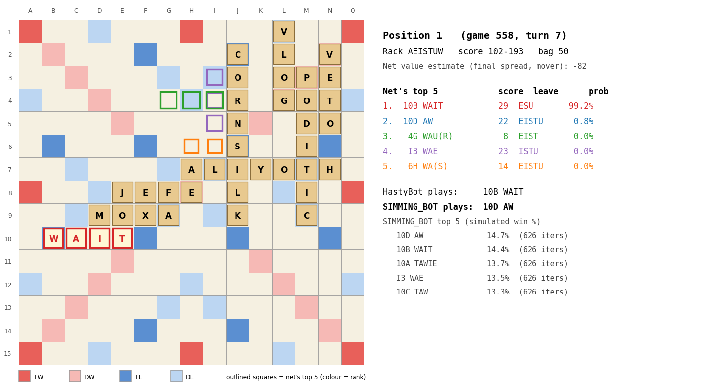
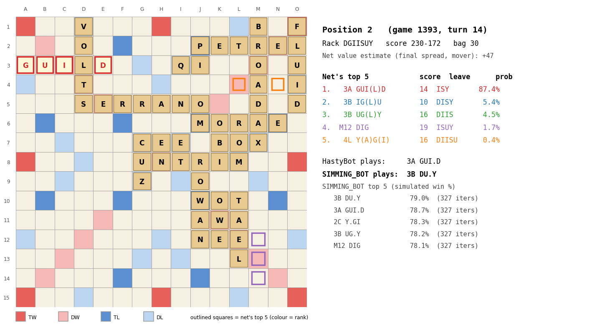
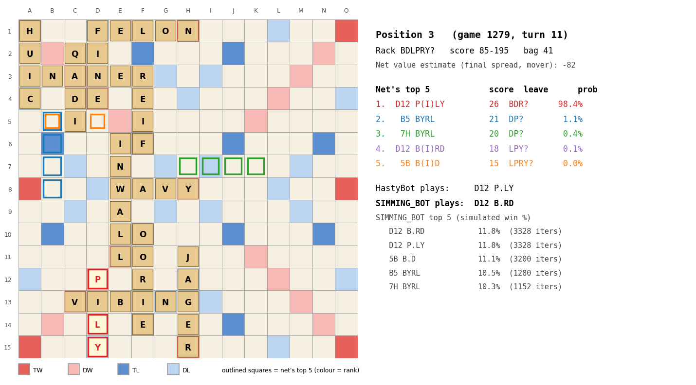
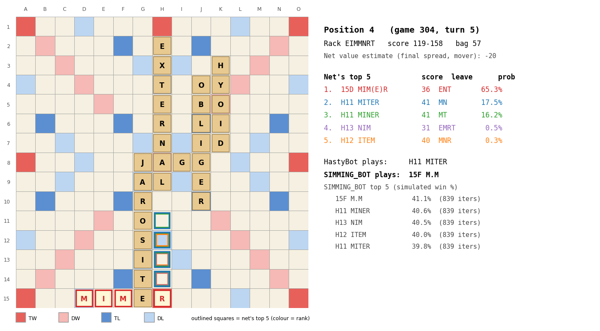
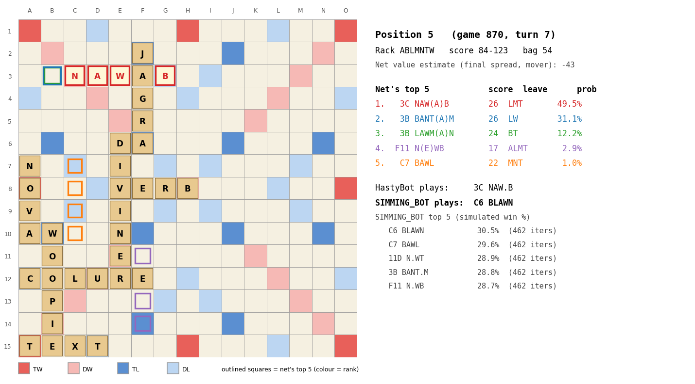
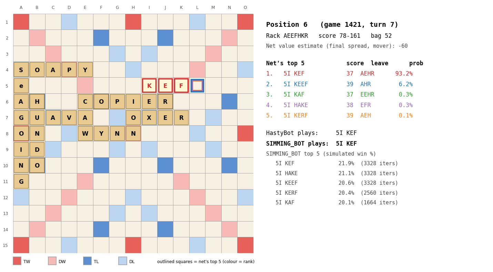

# Policy net top-5 on held-out mid-game positions

Checkpoint `policy_imit3_nolex.pt`; positions from `games_hasty_test` (HastyBot self-play, never trained on), 30-60 tiles in the bag. SIMMING_BOT = Macondo's sim bot, 10 s, one thread; win % is its simulated win probability for that move.

## Position 1

Rack `AEISTUW`, score 102-193, bag 50.

| # | move | score | leave | net prob |
|---|---|---|---|---|
| 1 | 10B WAIT | 29 | ESU | 99.2 % |
| 2 | 10D AW | 22 | EISTU | 0.8 % |
| 3 | 4G WAU(R) | 8 | EIST | 0.0 % |
| 4 | I3 WAE | 23 | ISTU | 0.0 % |
| 5 | 6H WA(S) | 14 | EISTU | 0.0 % |

HastyBot: `10B WAIT` · SIMMING_BOT: `10D AW` (10D AW 14.7 %, 10B WAIT 14.4 %, 10A TAWIE 13.7 %, I3 WAE 13.5 %, 10C TAW 13.3 %)

## Position 2

Rack `DGIISUY`, score 230-172, bag 30.

| # | move | score | leave | net prob |
|---|---|---|---|---|
| 1 | 3A GUI(L)D | 14 | ISY | 87.4 % |
| 2 | 3B IG(L)U | 10 | DISY | 5.4 % |
| 3 | 3B UG(L)Y | 16 | DIIS | 4.5 % |
| 4 | M12 DIG | 19 | ISUY | 1.7 % |
| 5 | 4L Y(A)G(I) | 16 | DIISU | 0.4 % |

HastyBot: `3A GUI.D` · SIMMING_BOT: `3B DU.Y` (3B DU.Y 79.0 %, 3A GUI.D 78.7 %, 2C Y.GI 78.3 %, 3B UG.Y 78.2 %, M12 DIG 78.1 %)

## Position 3

Rack `BDLPRY?`, score 85-195, bag 41.

| # | move | score | leave | net prob |
|---|---|---|---|---|
| 1 | D12 P(I)LY | 26 | BDR? | 98.4 % |
| 2 | B5 BYRL | 21 | DP? | 1.1 % |
| 3 | 7H BYRL | 20 | DP? | 0.4 % |
| 4 | D12 B(I)RD | 18 | LPY? | 0.1 % |
| 5 | 5B B(I)D | 15 | LPRY? | 0.0 % |

HastyBot: `D12 P.LY` · SIMMING_BOT: `D12 B.RD` (D12 B.RD 11.8 %, D12 P.LY 11.8 %, 5B B.D 11.1 %, B5 BYRL 10.5 %, 7H BYRL 10.3 %)

## Position 4

Rack `EIMMNRT`, score 119-158, bag 57.

| # | move | score | leave | net prob |
|---|---|---|---|---|
| 1 | 15D MIM(E)R | 36 | ENT | 65.3 % |
| 2 | H11 MITER | 41 | MN | 17.5 % |
| 3 | H11 MINER | 41 | MT | 16.2 % |
| 4 | H13 NIM | 31 | EMRT | 0.5 % |
| 5 | H12 ITEM | 40 | MNR | 0.3 % |

HastyBot: `H11 MITER` · SIMMING_BOT: `15F M.M` (15F M.M 41.1 %, H11 MINER 40.6 %, H13 NIM 40.5 %, H12 ITEM 40.0 %, H11 MITER 39.8 %)

## Position 5

Rack `ABLMNTW`, score 84-123, bag 54.

| # | move | score | leave | net prob |
|---|---|---|---|---|
| 1 | 3C NAW(A)B | 26 | LMT | 49.5 % |
| 2 | 3B BANT(A)M | 26 | LW | 31.1 % |
| 3 | 3B LAWM(A)N | 24 | BT | 12.2 % |
| 4 | F11 N(E)WB | 17 | ALMT | 2.9 % |
| 5 | C7 BAWL | 22 | MNT | 1.0 % |

HastyBot: `3C NAW.B` · SIMMING_BOT: `C6 BLAWN` (C6 BLAWN 30.5 %, C7 BAWL 29.6 %, 11D N.WT 28.9 %, 3B BANT.M 28.8 %, F11 N.WB 28.7 %)

## Position 6

Rack `AEEFHKR`, score 78-161, bag 52.

| # | move | score | leave | net prob |
|---|---|---|---|---|
| 1 | 5I KEF | 37 | AEHR | 93.2 % |
| 2 | 5I KEEF | 39 | AHR | 6.2 % |
| 3 | 5I KAF | 37 | EEHR | 0.3 % |
| 4 | 5I HAKE | 38 | EFR | 0.3 % |
| 5 | 5I KERF | 39 | AEH | 0.1 % |

HastyBot: `5I KEF` · SIMMING_BOT: `5I KEF` (5I KEF 21.9 %, 5I HAKE 21.1 %, 5I KEEF 20.6 %, 5I KERF 20.4 %, 5I KAF 20.1 %)
